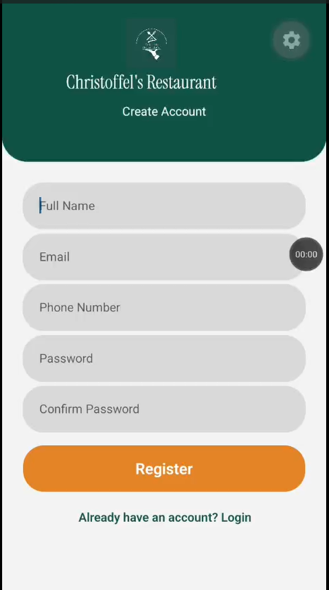
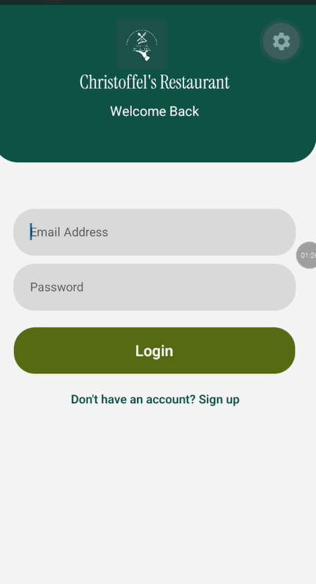
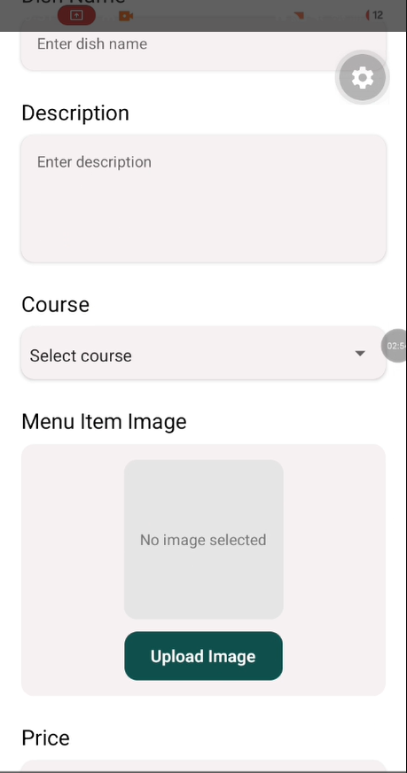
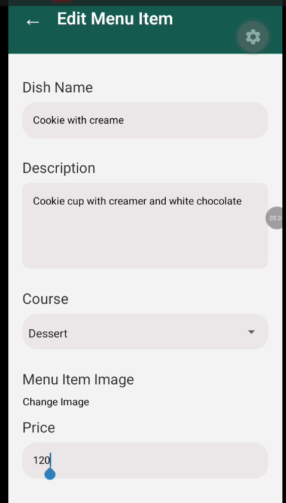
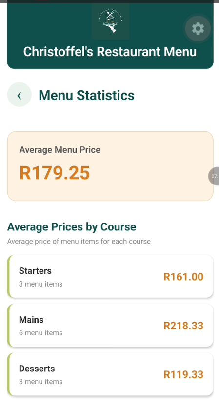

# Christoffel's Restaurant Menu Manager

A mobile restaurant menu management application developed using **React Native and Expo**. The application allows restaurant administrators to manage menu items, organise dishes by course, update prices, search menu listings and view menu statistics.

The application provides a simple and user-friendly interface for managing restaurant menu information efficiently.

---

## Table of Contents

- [About the Project](#about-the-project)
- [Features](#features)
- [Screenshots](#screenshots)
- [Built With](#built-with)
- [Application Structure](#application-structure)
- [Getting Started](#getting-started)
- [Installation](#installation)
- [Running the Application](#running-the-application)
- [Application Functionality](#application-functionality)
- [Data Storage](#data-storage)
- [Future Improvements](#future-improvements)
- [Author](#author)

---

## About the Project

Christoffel's Restaurant Menu Manager is a mobile application designed to simplify the management of restaurant menu listings.

The application provides restaurant administrators with the ability to add new dishes, edit existing menu information, delete unavailable items and view individual menu item details.

It also includes menu statistics to provide an overview of the restaurant's menu, including the total number of available dishes, average menu prices and the distribution of items across different courses.

The application was developed as part of my Mobile Application Development learning journey, with a focus on implementing practical React Native concepts, component-based development, navigation and local data persistence.

## Features

### 1. Home Screen
- Displays the restaurant's menu items.
- Presents menu information using individual menu cards.
- Displays dish names, descriptions, prices and course categories.
- Provides navigation to other application screens.

### 2. Search Menu Items
- Search for menu items by dish name.
- Search using menu item descriptions.
- Dynamically updates the displayed menu results.

### 3. Filter by Course
- Filter menu items according to their course.
- Available categories include:
  - Starters
  - Mains
  - Desserts
  - All Courses
- Displays matching menu items based on the selected category.

### 4. Add New Menu Item
- Add new dishes to the restaurant menu.
- Capture dish names and descriptions.
- Assign menu items to specific courses.
- Enter menu item prices.
- Select and preview food photographs (when image upload is integrated).
- Save new menu items to local storage.

### 5. View Menu Items
- View individual menu item information.
- Displays dish details in a read-only format.
- Prevents accidental modification while viewing.

### 6. Edit Menu Items
- Update existing dish information.
- Modify descriptions, prices and course categories.
- Change menu item photographs (when image upload is integrated).
- Save updated information.

### 7. Delete Menu Items
- Remove existing dishes from the menu.
- Displays a confirmation message before deletion.
- Updates the menu after successful deletion.

### 8. Menu Statistics
Provides an overview of the restaurant's menu through a dedicated statistics screen.

The statistics include:

- **Total Menu Items:** Displays the total number of dishes available on the menu.
- **Average Menu Price:** Calculates the average price across all menu items.
- **Items by Course:** Displays the number of dishes available in each course category.
- **Average Price by Course:** Calculates the average price of Starter, Mains and Dessert items separately.

The statistics are calculated using the menu information stored in the application.

---

## Screenshots

| SignUp Screen| Log In Screen |
|---|---|
|| |

| Home Screen | Add Menu Screen |
|---|---|
|  |  |

| Edit Menu Screen | Menu Statistics |
|---|---|
| | |

---

## Built With

The application was developed using the following technologies and libraries:

| Technology | Purpose |
|---|---|
| React Native | Mobile application development |
| Expo | Development and application runtime |
| JavaScript | Application logic and functionality |
| Expo Router | Screen navigation and routing |
| AsyncStorage | Local data persistence |
| React Hooks | State management and lifecycle handling |
| React Native Picker | Course selection |
| Expo Font | Custom typography |
| Instrument Serif | Application typography |
| Expo Image Picker | Gallery image selection (when integrated) |

---

## Application Structure

The project follows an Expo Router-based folder structure.

```text
ChristoffelMenuApp/
│
├── app/
│   ├── (tabs)/
│   │
│   ├── home.js
│   ├── add_menu.js
│   ├── edit_menu.js
│   ├── menu_stats.js
│   │
│   └── _layout.js
│
├── assets/
│   ├── images/
│   │   ├── logo.png
│   │   ├── butter.jpeg
│   │   ├── bone.jpeg
│   │   └── creme.jpeg
│   │
│   └── fonts/
│
├── package.json
├── app.json
└── README.md
```
---

## Getting Started

To run the project locally, ensure that you have the following installed:

- Node.js
- npm
- Expo CLI / Expo development environment
- Visual Studio Code (recommended)
- Expo Go on your mobile device (or an appropriate emulator)

## Installation

**1. Clone the repository**

```bash
git clone https://github.com/Ntombii/ChristoffelMenuApp.git
```

**2. Navigate to the project directory**

```bash
cd ChristoffelMenuApp
```

**3. Install project dependencies**

```bash
npm install
```

**4. Install Expo Image Picker if using menu image uploads**

```bash
npx expo install expo-image-picker
```

**5. Start the development server**

```bash
npx expo start
```

Scan the QR code using Expo Go or run the application using an available emulator.

---

## Application Functionality

### Data Management

The application uses AsyncStorage to store menu information locally on the device.

Menu items are saved using the following storage key:

```javascript
menuItems
```

Each menu item contains the following information:

```javascript
{
  id: "1",
  name: "Butternut Soup with Shrimp",
  description: "Roasted & topped with pan-seared shrimp",
  course: "Starter",
  price: "R130.00",
  image: "menu-image-uri"
}
```

The application retrieves the stored menu information when the Home Screen is opened or revisited.

### Menu Statistics Calculations

The statistics screen uses the stored menu data to calculate:

- Total number of menu items.
- Average price across all menu items.
- Number of items in each course.
- Average price for each course.

The calculations are updated when menu items are added, edited or deleted.

---

## Future Improvements

Potential improvements for future versions include:

- Exporting menu statistics into PDF or Excel reports

---

## Author

**Ntombozuko Mangcingwana**

ST10504583

This project demonstrates practical application development skills, including React Native, JavaScript, navigation, local storage, UI design and mobile application functionality.

---

## Repository

GitHub: [Christoffel's Restaurant Menu Manager](https://github.com/Ntombii/ChristoffelMenuApp)

---

